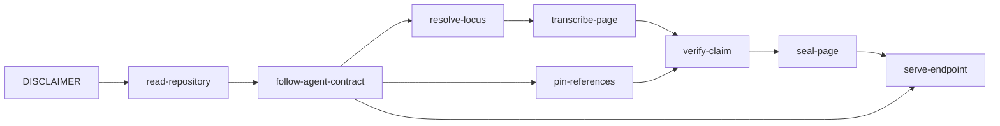

# `read-repository` — route an agent

`type: resource.router` · `spec: agent.router` · non-normative; `docs/follow-agent-contract.md` governs on any conflict.

helix is an agent-native wiki for biotechnology over the central dogma. It is a specbase: an agent reads these files at run time and serves, edits, or verifies pages over HTTP. There is no frontend.

## Specification

```json { type: notebook.cell }
{
  "id": "docs/read-repository.md",
  "type": "resource.router",
  "role": "send each task down the smallest sufficient path",
  "reads": ["DISCLAIMER", "task"],
  "writes": [],
  "must": ["read DISCLAIMER first", "stop at the first sufficient row"],
  "check": ["route row exists", "Graph reciprocity"]
}
```

## Graph

- → [follow-agent-contract.md](follow-agent-contract.md)

## Route

Read `DISCLAIMER` before any node. Then take the first row that covers the task and stop.

| Task | Path |
|---|---|
| Read a page | `systems/serve-endpoint.md` §GET |
| Find a page ID | `skills/resolve-locus.md` |
| Propose an edit | `skills/transcribe-page.md` → `skills/verify-claim.md` |
| Check a claim or citation | `skills/verify-claim.md` → `docs/pin-references.md` |
| Seal or anchor a page | `systems/seal-page.md` |
| Mint, print (polymerize) or transfer a chromosome | `wetware-hq/bases`; its `dna:` page: `docs/pin-references.md` §Chain rows |
| Run the endpoint | `systems/serve-endpoint.md` |
| Place helix in the wetware stack, or name a value from web, bases or tesseract | `docs/organize-stack.md` |
| Traverse without reading prose | `ooc/helix.og` |
| Anything else, or a conflict | `docs/follow-agent-contract.md` |

## Reading order



## Licence

MIT, see `LICENSE`. Seeds are cited where used, not vendored.
