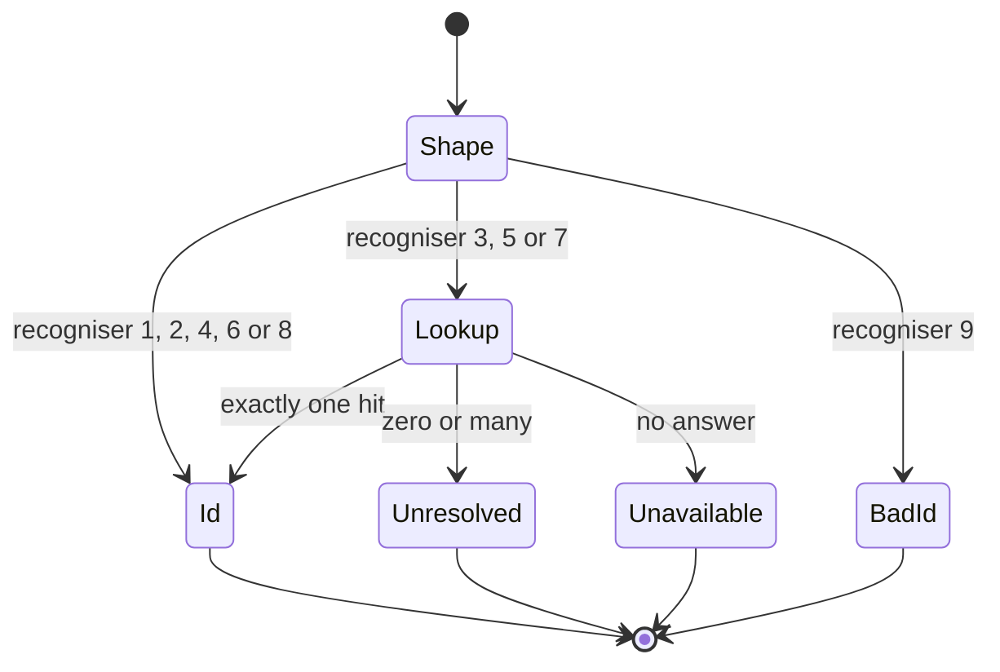

# `resolve-locus` — name to page ID

`type: resource.procedure` · `spec: agent.skill` · subordinate to `docs/follow-agent-contract.md`, which governs on any conflict.

Turn a gene symbol, accession, structure code or PMID into one helix page ID, or into one typed failure. Read-only.

## Specification

```json { type: notebook.cell }
{
  "id": "skills/resolve-locus.md",
  "type": "resource.procedure",
  "role": "resolve a name to one page ID",
  "reads": ["name or accession", "authority release", "genome.json"],
  "writes": [],
  "must": ["exact lookup only", "separate unresolved from unavailable"],
  "check": ["H1", "H10"]
}
```

## Graph

- ← [../docs/follow-agent-contract.md](../docs/follow-agent-contract.md)
- → [transcribe-page.md](transcribe-page.md)

## Indications

- An agent has `EGFR`, `P00533`, `1M17`, `ENST00000275493.7` or `PMID 4913914` and needs the page.

## Contraindications

- No fuzzy search, no alignment, no model guess.
- A resolved ID may have no page yet; that is `unknown_locus`, not a resolver failure.

## Algorithm

Recognisers are tried in this order and only the first that matches runs, so an all-digit input is always a PMID.

```text { type: notebook.cell }
resolve : Name -> Id | unresolved | unavailable | bad_id
  1  matches §0 id and its namespace pattern     -> Id               # no lookup
     matches §0 id shape only (e.g. pdb:1m17)   -> bad_id           # one spelling per object
  2  ^(PMID:?\s?)?[1-9][0-9]{0,8}$             -> pmid:<n>
  3  ^10\.[0-9]{4,9}/\S+$  (DOI)                 -> Europe PMC DOI lookup -> pmid:<n>
  4  ^ENS[GT][0-9]{11}(\.[0-9]+)?$               -> ensembl:<stable id, version dropped>
  5  UniProt pattern                            -> UniProt and HGNC lookups   # see below
  6  ^[1-9][A-Za-z0-9]{3}$  (PDB code)           -> pdb:<code, uppercase>
  7  ^[A-Z][A-Z0-9-]{0,14}$ (gene symbol)        -> HGNC fetch/symbol -> hgnc:<n>
  8  ^0x[0-9a-fA-F]{1,32}$  (Bases token id)      -> dna:<id, lowercase, zero-padded to 32>
  9  anything else                               -> bad_id
lookup result:
  exactly one hit       -> Id
  zero or many hits     -> unresolved      # final for this release
  429, 5xx or timeout   -> unavailable     # retry, cache nothing
```

The UniProt pattern is `^([OPQ][0-9][A-Z0-9]{3}[0-9]|[A-NR-Z][0-9]([A-Z][A-Z0-9]{2}[0-9]){1,2})$`. Some gene symbols also fit it (`P2RY12`, `B3GAT1`). So recogniser 5 looks up the input both as a UniProt accession and as an HGNC symbol: exactly one hit is the answer, zero or two hits are `unresolved`. Recognisers 1, 2, 4, 6 and 8 check only shape and make no network call; `skills/verify-claim.md` step 4 confirms existence when a page is created. A token id longer than 128 bits is `bad_id`. `rna:` and `aas:` are reserved and return `bad_id`. The result is then looked up in `genome.json`: a resolved ID with no locus is `unknown_locus` to readers, not a resolver failure.



Example: `EGFR` → `hgnc:3236`. The protein page `uniprot:P00533` is reached by following `same-as`, `transcribed-to` and `translated-to` claims in `genome.json`.

## Falsification

- Two runs on the same release return different IDs for the same name.
- An outage is returned as `unresolved`.

## Licence

MIT, see `LICENSE`.
