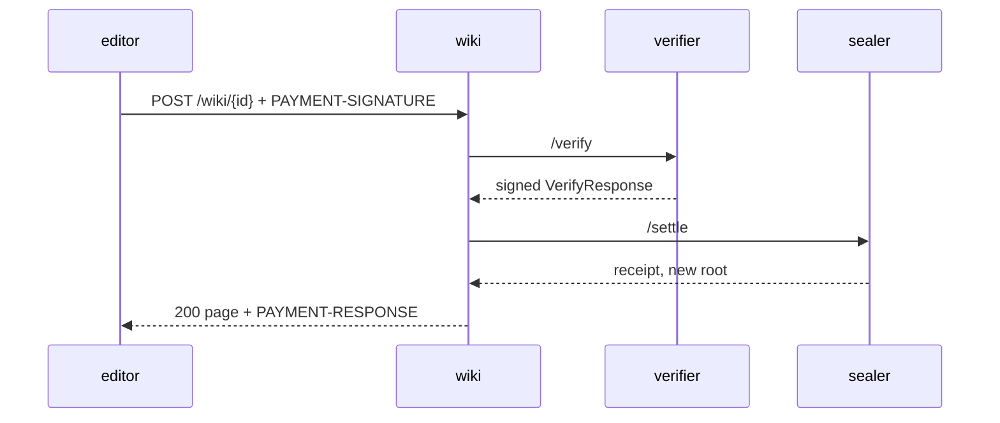

# `seal-page` — settle an edit

`type: resource.system` · `spec: agent.system` · subordinate to `docs/follow-agent-contract.md`, which governs on any conflict.

Append a verified edit to the genome, compute the new root, and return a receipt. This is the only step that writes. It plays the role of x402 `/settle`.

## Specification

```json { type: notebook.cell }
{
  "id": "systems/seal-page.md",
  "type": "resource.system",
  "role": "append verified claims and return the new root",
  "reads": ["PaymentPayload", "signed VerifyResponse", "genome.json"],
  "writes": ["genome.json", "ooc/helix.og (derived)"],
  "must": ["one store lock", "receipt lookup before parent check", "atomic write", "three distinct keys"],
  "check": ["H4", "H5", "H9", "H11"]
}
```

## Graph

- ← [../skills/verify-claim.md](../skills/verify-claim.md)
- → [serve-endpoint.md](serve-endpoint.md)

## Indications

- After `/verify` returns a signed `isValid: true` for an edit.

## Contraindications

- Never settle without a verifier signature over the same RNA digest.
- Never call a mainnet facilitator or move funds.

## Algorithm

```text { type: notebook.cell }
POST /settle body = { paymentPayload, offer, verifyResponse }; sealer = this agent's key

settle(payload, offer, vr, sealer):
  if Helix-Signature is not valid from a roles.endpoint key: return fail(no_role)
  rna := payload.payload.rna; d := hex(sha256(JCS(rna))); e := rna.editor
  info := offer.extensions["helix-page"].info
  if not ed25519_valid(e, payload.payload.sig, raw(d)): return fail(bad_envelope)   # raw = the 32 bytes
  lock(store)                                        # one lock for the whole genome
  r := receipts[e + ":" + rna.key]
  if r and r.rna == d: unlock; return r.response     # idempotent retry, same SettleResponse
  if r:                unlock; return fail(replay)
  if vr.rna != d or vr.offer != hex(sha256(JCS(offer))) or vr.payer != e
     or not valid(vr.sig) or not vr.isValid:         unlock; return fail(bad_envelope)
  if vr.verifier not in roles.verifier or sealer not in roles.sealer:     unlock; return fail(no_role)
  if |{e, vr.verifier, sealer}| != 3:                unlock; return fail(self_verify)
  if rna.nonce in spent or now > rna.expires
     or info.endpoint not in roles.endpoint or not valid(info.offerSig, info.endpoint): unlock; return fail(expired)
  locus := loci[rna.id] or { claims: [], root: root(empty) }   # page creation
  if rna.parent != locus.root:                       unlock; return fail(stale_parent)
  if any cid repeats in rna.append or is in locus:   unlock; return fail(duplicate)
  for c in rna.append: locus.claims += c; locus.root = hex(sha256(locus.root || chash(c)))
  receipt  := { rna: d, id: rna.id, root: locus.root, editor: e, verifier: vr.verifier, sealer, at: now }
  response := { success: true, transaction: locus.root, network: "helix:1", payer: e,
                extensions: { "helix-receipt": { info: { receipt, sig: sign(sealer, sha256(JCS(receipt))) } } } }
  receipts[e + ":" + rna.key] = { rna: d, response }
  spent[rna.nonce] = rna.expires; drop spent entries whose expiry has passed
  write genome.json.tmp, fsync, rename to genome.json
  rebuild ooc/helix.og from genome.json, write .tmp, rename; unlock
  return response

fail(code) = { success: false, errorReason: code, transaction: "", network: "helix:1", payer: e }
```

- The endpoint keeps each issued offer by `nonce` until it expires and passes it to `/verify` and `/settle`. Offers are not stored in `genome.json`; after a restart they are gone and edits against them are `expired`.
- The receipt is signed by the sealer, so any client can check who settled the edit and what root it produced.
- `spent` keeps a used nonce until its offer expires; after that the offer is refused by its expiry anyway.
- The receipt lookup runs before the parent check, so a retry after success gets the original receipt instead of `stale_parent`.
- Checks that depend on state that can change after `/verify` (nonce, parent, duplicates) are repeated under the lock. Source checks are not: they depend only on the pinned authority values, which `/verify` already signed for.
- One lock covers the whole store, because every page lives in one `genome.json`. This is a prototype limit; a store per page would allow a lock per page.
- `genome.json` is the only canonical file, and one rename publishes it. `ooc/helix.og` is derived and rebuilt under the same lock, so rebuilds cannot interleave. Rebuild: route nodes are fixed; each locus gets one `page` node holding its full root and claim count, with an edge per `id` object of a counted template claim at `fulltext-claim-checked` or above, and a `hypothesis` edge for every other `id` object, so an index-only agent never mistakes a lead for a fact; `checksum` is SHA-256 over the file with the checksum line removed, as in `catalog`. `GET /index` takes the lock, compares the index roots with `genome.json`, and rebuilds first if they differ, so no reader sees a mismatched pair. A crash can leave the index stale, never the genome.
- `transaction` holds the new root, so the x402 `SettleResponse` shape is unchanged. A later anchor may write the same root to a chain or IPFS and return `settlement_pending` until it lands.

```text { type: notebook.cell }
root(empty) = 9e870b27ebdb0df84bcb5d4391a72e17b5eccfb75af047d179523fd285672799
```



## Falsification

- Retrying a settled key with the same RNA changes the root or returns an error.
- A root in `genome.json` differs from the fold over its claims.
- Two settles against the same parent both succeed.

## Licence

MIT, see `LICENSE`.
